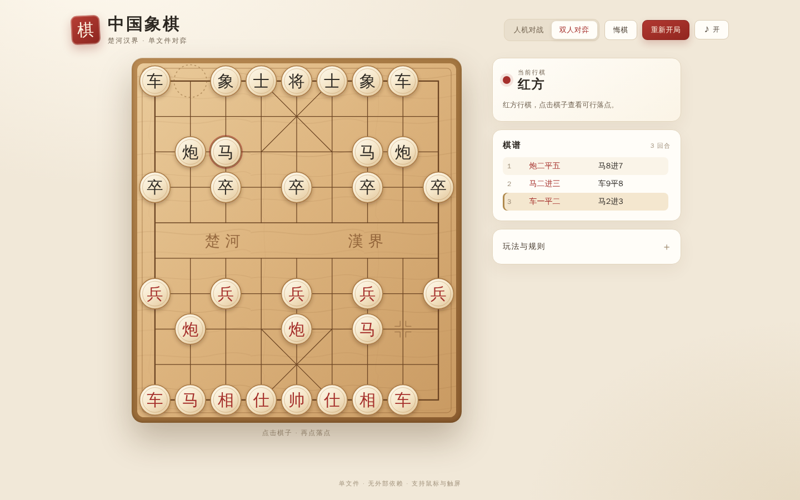
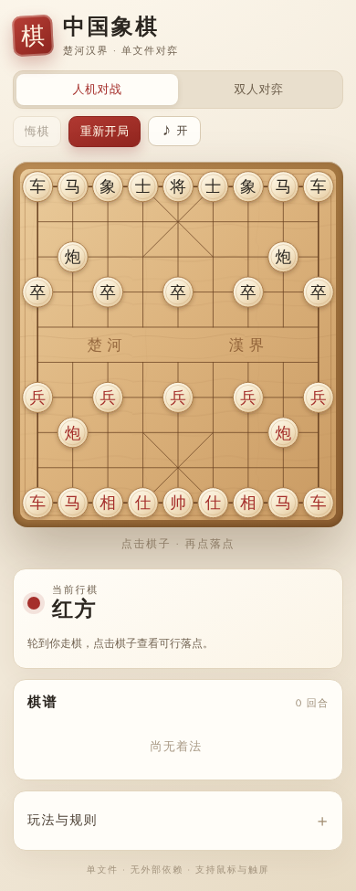

# 单文件网页合集 · 八卦 / 中国象棋

本仓库包含两个互相独立的单文件网页，均内联全部样式与脚本、零外部依赖、双击即用：

| 页面 | 入口 | 说明 |
| --- | --- | --- |
| 八卦 | [`index.html`](index.html) | 先天/后天八卦图盘、卦象详情、取象歌与阴阳讲解 |
| 中国象棋 | [`chess.html`](chess.html) | 人机对战/双人对弈、将军将死困毙、悔棋、中文棋谱、音效、响应式 |

两者互不依赖，可单独打开；下方为各自的详细说明。

---

# 八卦 · 中国古代哲学符号

一个展示中国古代「八卦」的交互式单文件网页。八卦——乾、兑、离、震、巽、坎、艮、坤——是《易经》的核心符号，也是中国古代先哲观察宇宙万物的基本图式。全部样式、脚本与图形均内联在单个 `index.html` 中：无构建步骤、无框架、无外部资源，也不发起任何网络请求。


## 功能一览

- **八卦图盘**：八个卦象按圆盘排布，中央为缓缓旋转的太极图；点击任意卦象即可高亮选中。
- **先天 / 后天排布**：一键在「先天八卦」（伏羲）与「后天八卦」（文王）两种方位排布之间切换，方位刻度随之更新。
- **卦象详情**：展示卦名、拼音、卦形符号、自然之象（天、泽、火、雷、风、水、山、地）、方位、五行、家族与卦德，并附《易传》取义原文。
- **取象歌**：收录「乾三连、坤六断、震仰盂、艮覆碗、离中虚、坎中满、兑上缺、巽下断」等口诀，便于记忆卦形。
- **阴阳讲解**：说明阳爻「—」与阴爻「--」的含义，以及「太极生两仪，两仪生四象，四象生八卦」的推演关系。
- **自适应布局**：桌面与手机均可流畅浏览，鼠标与触屏皆可操作。
- **离线可用**：双击 `index.html` 即可打开，无需服务器或联网。

## 快速开始

方式一：直接双击 `index.html`。

方式二：在目录中启动任意静态服务器：

```bash
python3 -m http.server 8000
```

然后打开 <http://localhost:8000>，无需安装任何依赖。

## 操作方式

1. 点击八卦图盘中的卦象，或下方「八卦一览」中的卡片，即可选中该卦。
2. 选中后，图盘高亮该卦，下方详情面板同步显示其卦名、自然、方位、五行等信息。
3. 点击顶部「先天八卦 / 后天八卦」切换排布方式，观察八个卦象方位的变化。
4. 页面底部「阴阳与卦象」一栏，可查阅阴阳爻的说明与八卦取象歌。

## 八卦简表

| 卦名 | 卦形 | 自然 | 后天方位 | 五行 | 家族 | 卦德 |
| --- | --- | --- | --- | --- | --- | --- |
| 乾 | ☰ | 天 | 西北 | 金 | 父 | 健 |
| 兑 | ☱ | 泽 | 西 | 金 | 少女 | 悦 |
| 离 | ☲ | 火 | 南 | 火 | 中女 | 丽 |
| 震 | ☳ | 雷 | 东 | 木 | 长男 | 动 |
| 巽 | ☴ | 风 | 东南 | 木 | 长女 | 入 |
| 坎 | ☵ | 水 | 北 | 水 | 中男 | 陷 |
| 艮 | ☶ | 山 | 东北 | 土 | 少男 | 止 |
| 坤 | ☷ | 地 | 西南 | 土 | 母 | 顺 |

> 说明：卦象的「方位」为后天八卦（文王八卦）的排布；先天八卦（伏羲八卦）以乾南、坤北为序，两者可在网页中切换对照。

---

# 中国象棋 · 单文件网页版

单文件实现的中国象棋：完整对弈规则、人机与双人两种模式、中文棋谱记录与悔棋，样式脚本全部内联在 `chess.html` 一个文件中，无构建、无框架、无外部资源，双击即可开局。


## 功能一览

- **完整规则**：马腿、象眼、炮架、过河兵、九宫限制、送将与将帅照面判定、将死与困毙判定，60 回合无吃子判和。
- **两种模式**：人机对战（迭代加深 + alpha-beta 搜索，含吃子延伸，约 0.9 秒应手）与双人对弈。
- **棋谱记录**：中文着法逐回合记录，显示当前行棋方与回合数。
- **悔棋**：支持连续悔棋，吃子可回滚。
- **音效**：落子与提示音，可一键开关。
- **响应式**：桌面与手机布局均可正常游玩，支持鼠标与触屏。





## 操作方式

1. 双击 `chess.html` 打开（或经静态服务器访问 `chess.html`）。
2. 点击棋子查看可行落点，再点击落点完成走子。
3. 顶部可切换「人机对战 / 双人对弈」，随时悔棋或重新开局。

## 已知限制

- 未实现长将、长捉与三次重复局面判和，采用 60 回合无吃子判和。
- 人机 AI 为休闲强度，不支持难度调节。

## 项目结构

```
.
├── index.html            # 八卦网页（全部内联）
├── chess.html            # 中国象棋网页（全部内联）
├── README.md             # 本说明文档
├── TEST_REPORT.md        # 八卦网页自动化测试报告
└── docs/
    ├── screenshots/      # 界面截图（chess*.png 为象棋，其余为八卦）
    └── evidence/         # 前后对比截图
```
