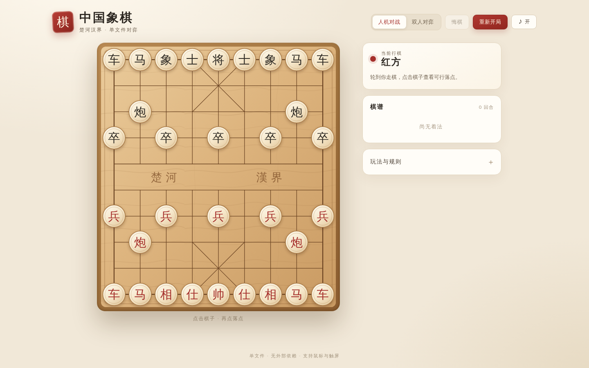

# 中国象棋 · 单文件网页版

一款打开即玩的网页版中国象棋。棋盘、棋子、规则引擎、AI 和界面全部内联在单个 `index.html` 中，无构建步骤、无框架、无外部资源，也不发起网络请求。



## 功能一览

- **核心走子与胜负规则完整**：马腿、象眼、炮架、九宫、过河兵、将帅照面、将军 / 应将、将死、困毙。
- **两种模式**：人机对战（你执红先行，本地 AI 执黑）与双人同屏对弈。
- **中文棋谱**：按照传统记谱法实时记录，如“炮二平五”“马8进7”。
- **顺手的小功能**：悔棋、重新开局、音效开关、最后一步高亮、可落点提示、将军提示、60 回合无吃子判和。
- **自适应布局**：桌面与手机皆可对弈；SVG 棋盘与棋子缩放清晰，鼠标和触屏均可操作。
- **离线可用**：双击 `index.html` 即可开始，不需要服务器或联网。

## 快速开始

方式一：直接双击 `index.html`。

方式二：在目录中启动任意静态服务器：

```bash
python3 -m http.server 8000
```

然后打开 <http://localhost:8000>。无需安装依赖。

## 操作方式

1. 点击己方棋子，棋盘上出现绿色圆点（可走位置）或绿色虚线圈（可吃棋子）。
2. 点击目标位置完成走子。
3. 点击另一枚己方棋子可切换选择；点击空白处或按 `Esc` 取消选择。
4. “悔棋”：双人模式回退一步；人机模式回退一个完整回合。
5. “重新开局”：立即开始新的一局。
6. 顶部可在“人机对战 / 双人对弈”之间切换，切换会重新开局。
7. 点击 `♪` 开关音效。

## 规则说明

| 棋子 | 走法 |
| --- | --- |
| 帅 / 将 | 九宫内走一步直线；双方将帅不能在同一路上直接照面 |
| 仕 / 士 | 九宫内斜走一步 |
| 相 / 象 | 斜走两格，不能过河；象眼被占则不能走 |
| 马 | 走“日”字；马腿被占则不能走 |
| 车 | 直线任意距离，不能越子 |
| 炮 | 移动同车；吃子必须隔且只隔一个棋子 |
| 兵 / 卒 | 向前一步；过河后可左右一步；不能后退 |

胜负判定：

- 被将军时必须应将，不能走出让己方将帅被攻击的着法；
- 将死（被将军且无合法着法）或困毙（未被将军但无合法着法）对方获胜；
- 连续 60 回合没有吃子判和。

> 为保证休闲对局体验，本项目未实现长将 / 长捉判罚和三次重复局面判和，采用“60 回合无吃子判和”的简化规则。

## 人机 AI

- 黑方由浏览器内的本地 AI 控制，不会上传棋局，也不会请求网络。
- 使用迭代加深 Negamax + Alpha-Beta 剪枝，并加入吃子延伸（quiescence search），避免在搜索边界漏看换子。
- 每步思考时间约 0.9 秒；棋力定位为休闲对弈，不追求专业引擎强度。
- 你固定执红先行。

## 项目结构

```text
.
├── index.html                 # 游戏本体（HTML + CSS + SVG + JavaScript，单文件）
├── README.md
└── docs/
    ├── screenshots/
    │   ├── after.png          # 桌面端对局界面
    │   ├── after-midgame.png  # 对局进行中
    │   └── after-mobile.png   # 手机端界面
    └── evidence/              # 本次改动的视觉对比基线
        ├── before-repo.png    # 初始仓库仅含 README.md
        └── before-route.png   # 初始 /index.html 返回 404
```

游戏本体只有 `index.html`，README 与截图仅用于说明。

## 实现要点

- **单文件**：所有样式、棋盘绘制、规则引擎、AI 和交互脚本都内联在 `index.html` 中，没有任何运行时依赖。
- **棋盘绘制**：SVG 绘制九路十行、楚河汉界、九宫斜线和兵 / 炮位标记；棋子是 SVG 组合，落子时用 CSS transform 过渡。
- **规则引擎**：先按棋子类型生成伪合法着法，再通过“执行后己方将帅是否被攻击 / 是否照面”统一过滤，因此送将、马腿、象眼、炮架等规则不会互相遗漏。
- **中文记谱**：根据局面检测同路同兵种，处理“前 / 中 / 后”前缀，并按红黑双方不同视角换算路数。
- **AI**：纯 JavaScript 实现 Negamax + Alpha-Beta + 吃子延伸，使用子力价值和简单位置分评估。
- **音效**：Web Audio 实时合成，不包含音频文件。
- **无网络**：没有外链字体、图片、脚本或统计代码，断网也能完整对弈。

## 浏览器支持

现代 Chrome、Edge、Firefox、Safari 均可运行，建议使用较新的浏览器版本。

## 说明

本项目用于学习与演示。棋谱、规则和 AI 均为本地实现；人机模式下的 AI 棋力有限，可按自己的需要调整 `index.html` 中的搜索时间、评估函数或界面样式。
