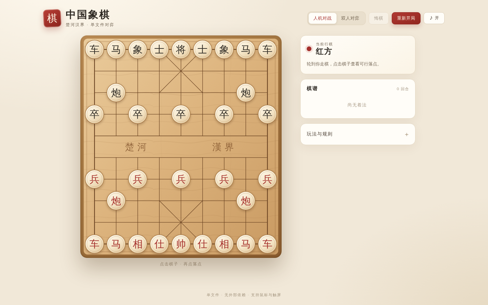
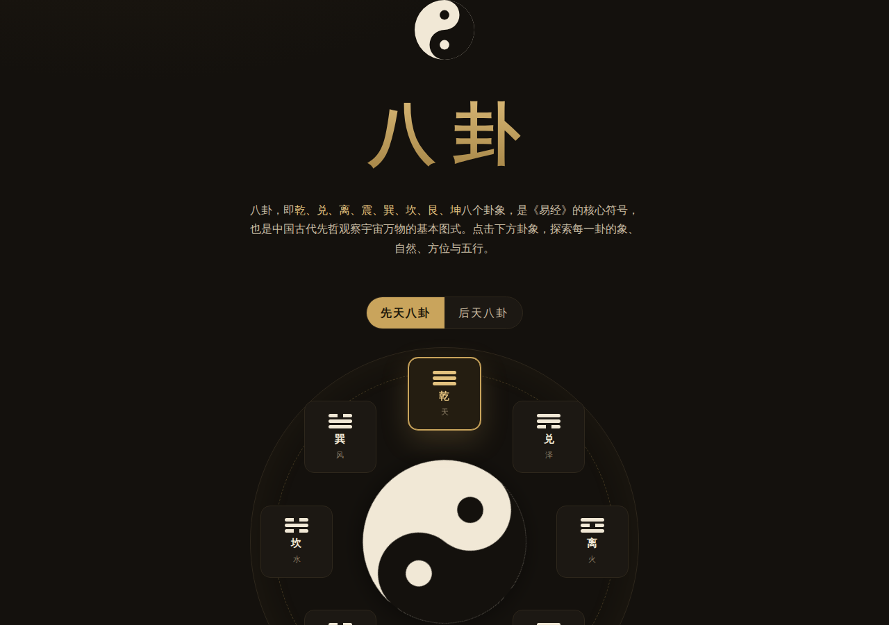
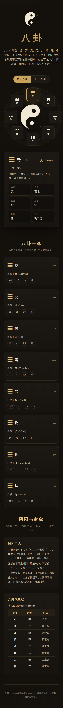
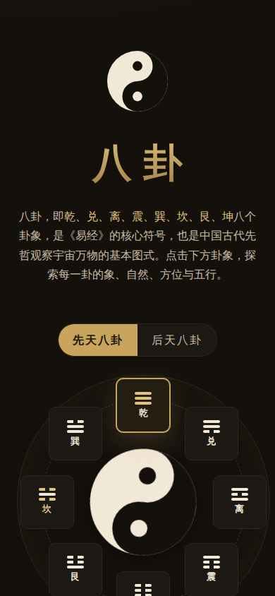

# 测试报告 · 八卦展示网页

> 本报告由自动化测试生成，覆盖「八卦 · 中国古代哲学符号」单文件网页（`index.html`）的加载、结构、数据正确性、交互、排布切换、响应式与离线行为。

## 一、测试概述

| 项目 | 内容 |
| --- | --- |
| 被测对象 | `index.html`（单文件八卦展示网页） |
| 测试日期 | 2026-11-03 |
| 测试方式 | Playwright（Chromium 无头浏览器）自动化 |
| 测试范围 | 功能、交互、排布正确性、响应式、离线（无网络请求） |

## 二、测试环境

| 环境项 | 值 |
| --- | --- |
| 浏览器 | Chromium（无头，Playwright 1.63） |
| 桌面视口 | 1280 × 900 |
| 移动视口 | 390 × 844 |
| 运行方式 | `file://` 直接加载（验证离线可用） |

## 三、测试结果汇总

| 统计项 | 数值 |
| --- | --- |
| 测试用例总数 | 25 |
| 通过 | 25 |
| 失败 | 0 |
| 通过率 | **100%** |
| 控制台错误 / 告警 | 0 |

## 四、测试用例明细

### 4.1 加载与结构

| # | 用例 | 结果 |
| --- | --- | --- |
| 1 | 页面加载无控制台报错或告警 | ✅ 通过 |
| 2 | 页面标题含「八卦」 | ✅ 通过 |
| 3 | `<html lang="zh-CN">` 声明正确 | ✅ 通过 |
| 4 | 渲染 8 个卦象节点 | ✅ 通过 |
| 5 | 渲染 8 张卦象卡片 | ✅ 通过 |
| 6 | 「先天八卦 / 后天八卦」两个切换按钮 | ✅ 通过 |
| 7 | 徽标太极图（SVG）渲染 | ✅ 通过 |
| 8 | 图盘中央太极图（SVG）渲染 | ✅ 通过 |
| 9 | 「阴阳二爻 / 取象歌」两个说明面板 | ✅ 通过 |
| 10 | 取象歌表格 8 行（表头 + 8 卦） | ✅ 通过 |

### 4.2 数据正确性

| # | 用例 | 结果 |
| --- | --- | --- |
| 11 | 8 张卡片卦名、拼音、卦形符号均与《易经》标准一致 | ✅ 通过 |

校验数据（乾兑离震巽坎艮坤 的卦名 / 拼音 / 卦形 / 自然 / 后天方位 / 五行 / 家族 / 卦德）：

| 卦 | 卦名 | 拼音 | 卦形 | 自然 | 方位 | 五行 | 家族 | 卦德 |
| --- | --- | --- | --- | --- | --- | --- | --- | --- |
| 乾 | qián | ☰ | 天 | 西北 | 金 | 父 | 健 |
| 兑 | duì | ☱ | 泽 | 西 | 金 | 少女 | 悦 |
| 离 | lí | ☲ | 火 | 南 | 火 | 中女 | 丽 |
| 震 | zhèn | ☳ | 雷 | 东 | 木 | 长男 | 动 |
| 巽 | xùn | ☴ | 风 | 东南 | 木 | 长女 | 入 |
| 坎 | kǎn | ☵ | 水 | 北 | 水 | 中男 | 陷 |
| 艮 | gèn | ☶ | 山 | 东北 | 土 | 少男 | 止 |
| 坤 | kūn | ☷ | 地 | 西南 | 土 | 母 | 顺 |

### 4.3 交互

| # | 用例 | 结果 |
| --- | --- | --- |
| 12 | 依次点击 8 个图盘节点，详情面板均正确切换 | ✅ 通过 |
| 13 | 依次点击 8 张卡片，详情面板均正确切换 | ✅ 通过 |
| 14 | 详情面板含 6 项属性（自然 / 方位 / 五行 / 家族 / 卦德 / 卦形） | ✅ 通过 |
| 15 | 详情面板显示对应取象歌 | ✅ 通过 |

### 4.4 排布切换

| # | 用例 | 结果 |
| --- | --- | --- |
| 16 | 默认排布为「先天八卦」 | ✅ 通过 |
| 17 | 先天：乾居南（顶部） | ✅ 通过 |
| 18 | 切换后「后天八卦」按钮激活 | ✅ 通过 |
| 19 | 后天：离居南（顶部） | ✅ 通过 |
| 20 | 切回先天：乾重新居南（顶部） | ✅ 通过 |
| 21 | 先天 / 后天全部 8 卦方位与经典排布一致 | ✅ 通过 |

排布实测坐标（`left/top` 百分比，方位以「上南下北」为准）：

- **先天八卦**：乾南、兑东南、离东、震东北、坤北、艮西北、坎西、巽西南 ✅
- **后天八卦**：离南、巽东南、震东、艮东北、坎北、乾西北、兑西、坤西南 ✅

### 4.5 响应式与离线

| # | 用例 | 结果 |
| --- | --- | --- |
| 22 | 桌面视口无横向溢出 | ✅ 通过 |
| 23 | 移动视口（390px）无横向溢出 | ✅ 通过 |
| 24 | 移动端图盘节点可点击并正确更新详情 | ✅ 通过 |
| 25 | 页面无任何外部网络请求（离线可用） | ✅ 通过 |

## 五、测试截图

| 场景 | 截图 |
| --- | --- |
| 桌面 · 完整页面 |  |
| 桌面 · 后天八卦排布 |  |
| 手机 · 完整页面 |  |
| 手机 · 点击「坎」后详情 |  |

## 六、结论

25 项测试用例全部通过，通过率 100%，无控制台错误或告警，无外部网络请求。

- 页面在桌面与移动端均能正常渲染，无横向溢出；
- 八卦数据（卦名、拼音、卦形、自然、方位、五行、家族、卦德）与经典文献一致；
- 先天 / 后天两种排布的 8 卦方位均正确；
- 图盘节点与卡片点击交互、详情切换、取象歌展示均符合预期。
